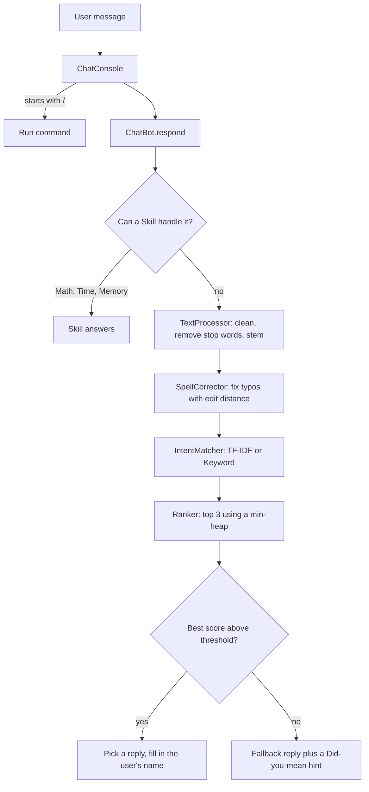

# Nova: an NLP Chatbot in Pure Java

Nova is a console chatbot built from scratch in Java with **no external libraries**. It understands what you type using classic Natural Language Processing (tokenizing, stemming, TF-IDF vectors and cosine similarity), fixes your typos with a dynamic-programming spell checker, solves math with a stack-based expression parser, and remembers things you tell it.

The project is designed to show clean **object-oriented design** and practical **data structures and algorithms**.

## Features

- **Intent recognition** across 37 topics (small talk, jokes, fun facts, computer-science Q&A)
- **Two swappable matching algorithms**: TF-IDF + cosine similarity, or Jaccard similarity with an inverted index (`/mode keyword`)
- **Typo tolerance**: "tell me a jokke" still works
- **Math engine**: `what is 15 * (4 + 2) - 3` -> `87`, with precedence, parentheses, powers and negatives
- **Memory**: remembers your name and things you like, and uses your name in replies
- **Context**: "another one" continues the last topic and never repeats the same reply twice in a row
- **Debug mode** that shows confidence scores, typo fixes and the top 3 guesses
- **Data-driven**: teach Nova new topics by editing `data/intents.txt`, no code changes
- **84 automated tests**, no test framework needed

## Sample conversation

```
You: hey there
Nova: Hi friend! What's on your mind?
You: my name is Jordan
Nova: Nice to meet you, Jordan! I'll remember your name.
You: tell me a jokke
Nova: How many programmers does it take to change a light bulb? None, that's a hardware problem.
You: another one
Nova: Why did the programmer quit his job? He didn't get arrays.
You: what is 15 * (4 + 2) - 3
Nova: 15 * (4 + 2) - 3 = 87
You: what is a stack
Nova: A stack is Last-In-First-Out (LIFO), like a stack of plates. You push onto the top and
      pop off the top. I use two stacks to solve math problems with the Shunting-Yard algorithm!
You: /debug
Debug mode is now ON.
You: whats the wether like
Nova: I run offline, so I can't check live weather. A weather app will know!
   [debug] answered by: intent 'weather' (confidence 1.00, matcher: tfidf)
   [debug] typo fixes: wether -> weather
   [debug] top matches: [weather (1.00), compliment (0.63), favorite (0.61)]
You: bye
Nova: See you later, Jordan!
```

## How to run

Requires **Java 17 or newer** (`java -version` to check).

**macOS / Linux**
```bash
./run.sh        # start the chatbot
./test.sh       # run the test suite
```

**Windows**
```bat
run.bat
test.bat
```

**IntelliJ IDEA / VS Code**: open the project folder, mark `src/main/java` as the source root, and run `com.nova.chatbot.Main`. Keep the working directory set to the project folder so the bot can find `data/intents.txt`.

### Commands

| Command | What it does |
|---|---|
| `/help` | list commands and things to try |
| `/topics` | list every topic Nova knows |
| `/history` | show the last 10 messages |
| `/mode tfidf` or `/mode keyword` | switch the matching algorithm while running |
| `/debug` | show how each answer was chosen |
| `/quit` | exit (saying "bye" also works) |

## How it works



1. **ChatConsole** reads a line. Slash-commands are handled by the UI; everything else goes to the bot.
2. **ChatBot** saves the message to history, then asks each **Skill** in order (math, time, memory). The first skill that recognises the message answers it.
3. Otherwise, **TextProcessor** lowercases the text, expands contractions, strips punctuation, removes filler words and stems each word (`"You're telling jokes!"` -> `[you, tell, joke]`).
4. **SpellCorrector** replaces unknown words with the closest known word if it is within 1-2 edits.
5. The active **IntentMatcher** scores every intent. **Ranker** keeps the best 3 with a min-heap.
6. If the best score passes the matcher's confidence threshold, Nova picks a random reply for that intent (never the same one twice in a row) and fills in `{name}`. If the user said "another one", it reuses the previous topic.

## Concepts demonstrated

### Object-oriented programming

| Concept | Where |
|---|---|
| Encapsulation | `UserProfile`, `Intent`, `Message`: private fields, validation in methods, defensive copies |
| Immutability | `Intent`, `Message`, `MatchResult`, `ChatResponse`: final fields, no setters |
| Abstraction (interface) | `IntentMatcher`: says *what* a matcher does, not *how* |
| Abstraction (abstract class) | `Skill`: shared fields and workflow, abstract steps |
| Inheritance | `MathSkill`, `TimeSkill`, `MemorySkill` extend `Skill` |
| Polymorphism | `ChatBot` calls `skill.tryRespond()` and `matcher.findTopMatches()` without knowing the concrete class |
| Composition | `ChatBot` *has* a knowledge base, processor, spell corrector, matchers, skills, history and profile |
| Enums | `Sender`, `ChatResponse.Source` |
| Custom checked exception | `KnowledgeBaseException`, with line numbers for bad input |
| `equals` / `hashCode` / `Comparable` | `Intent` is a safe `HashMap` key; `MatchResult` orders itself for the heap |
| Static factory methods | `KnowledgeBase.loadFromFile`, `ChatBot.createDefault`, `ChatResponse.fromSkill` |
| Dependency injection | `TimeSkill(Clock)` and `ChatBot(..., Random)` make tests repeatable |

### Design patterns

| Pattern | Where |
|---|---|
| Strategy | `IntentMatcher` with `TfIdfMatcher` and `KeywordMatcher`, swappable at runtime |
| Template Method | `Skill.tryRespond()` is final; subclasses fill in `canHandle()` and `handle()` |
| Chain of Responsibility | `ChatBot` passes each message along the list of skills until one handles it |
| Separation of Concerns | `ChatConsole` (UI) never touches matching logic; `ChatBot` never prints |

### Data structures

| Structure | Where | Why |
|---|---|---|
| `HashMap` | IDF weights, inverted index, intents by tag, typo cache | O(1) average lookup |
| `HashSet` | stop words, vocabulary, candidate patterns | O(1) membership checks |
| `LinkedHashSet` / `LinkedHashMap` | user's likes, contraction rules, typo fixes | no duplicates **and** predictable order |
| `ArrayList` | intents, tokens, pattern vectors | ordered, fast index access |
| Stack (`ArrayDeque`) | operator and value stacks in the math engine | LIFO for Shunting-Yard |
| Queue (`ArrayDeque`) | conversation history | FIFO sliding window, O(1) add and evict |
| Min-heap (`PriorityQueue`) | top-k intent ranking | O(n log k) instead of sorting everything |
| 2D array | edit-distance DP table | stores solved sub-problems |
| Inverted index | `KeywordMatcher` | only scores patterns that share a word with the input |

### Algorithms

| Algorithm | Where | Complexity |
|---|---|---|
| TF-IDF + cosine similarity | `TfIdfMatcher` | O(P x q) per message (P patterns, q words) |
| Jaccard similarity | `KeywordMatcher` | O(C x q) for C candidate patterns |
| Edit distance (Levenshtein plus adjacent swaps, dynamic programming) | `SpellCorrector` | O(n x m) per word pair |
| Memoization and pruning | `SpellCorrector` cache and length check | skips repeat and impossible work |
| Shunting-Yard (infix to postfix) | `ExpressionEvaluator` | O(n) |
| Postfix (RPN) evaluation | `ExpressionEvaluator` | O(n) |
| Top-k selection with a heap | `Ranker` | O(n log k) |
| Rule-based stemming and tokenizing | `TextProcessor` | O(length of text) |

## Project structure

```
java-ai-chatbot/
├── data/intents.txt                  knowledge base (37 topics)
├── src/main/java/com/nova/chatbot/
│   ├── Main.java                     entry point, wires objects together
│   ├── core/       ChatBot, ChatResponse
│   ├── knowledge/  Intent, KnowledgeBase, KnowledgeBaseException
│   ├── matching/   IntentMatcher, TfIdfMatcher, KeywordMatcher, MatchResult, Ranker
│   ├── memory/     ConversationHistory, Message, Sender, UserProfile
│   ├── nlp/        TextProcessor, SpellCorrector
│   ├── skills/     Skill, MathSkill, ExpressionEvaluator, TimeSkill, MemorySkill
│   └── ui/         ChatConsole
├── src/test/java/com/nova/chatbot/ChatBotTests.java
├── run.sh / run.bat
└── test.sh / test.bat
```

## Teach Nova something new

Add a block to `data/intents.txt` and restart:

```
[pets]
patterns: do you have a pet | do you like dogs | do you like cats
responses: I'd love a pet, but they don't fit in the JVM. | Dogs and cats are both great, {name}!
```

## Limitations and next steps

- Bag-of-words matching ignores word order, so "dog bites man" and "man bites dog" look the same.
- Memory lasts only for one session. Saving the profile to a file would make it persistent.
- Ideas: add a Swing or web UI on top of `ChatBot`, swap the custom tests for JUnit with Maven or Gradle, or add a `Trie` for autocomplete.
